# GroupTrip — Entity Relationship Diagram (Phase 1 proposal)

Status: **implemented** (Phase 1 — `backend/app/models.py`). Legend:

- `[keep]` — exists in the current scaffold, unchanged
- `[change]` — exists, but needs fields/constraints added or removed
- `[new]` — does not exist yet
- Priority: **P0** = research-critical, **P1** = needed for the core loop, **P2** = nice-to-have

The diagram shows key attributes only; the tables below list fields in full.

---

## Entities that already exist

`Trip`, `Member`, `Preference`, `Condition`, `Destination`, `Activity`, `Rating`, `PlanItem`, `RevisionLog`.

---

## Diagram

```mermaid
erDiagram
    STUDY_SESSION ||--o{ TASK_INSTANCE : "contains"
    SCENARIO ||--o{ TASK_INSTANCE : "used by"
    TASK_INSTANCE ||--|| TRIP : "produces"
    PARTICIPANT ||--o{ MEMBER : "joins as"
    TRIP ||--o{ MEMBER : "has"
    TRIP ||--o{ CONDITION : "has"
    TRIP ||--o{ PLAN_ITEM : "has"
    TRIP ||--o{ CONFLICT : "has"
    TRIP ||--o{ REVISION_LOG : "logs"
    TRIP ||--o{ RANKING_SNAPSHOT : "snapshots"
    MEMBER ||--o{ PROFILE_FIELD : "declares"
    MEMBER ||--o{ CONDITION : "owns"
    MEMBER ||--o{ RATING : "gives"
    MEMBER ||--o{ VETO : "casts"
    MEMBER ||--o{ APPROVAL : "gives"
    MEMBER ||--o{ EVENT_LOG : "acts in"
    MEMBER ||--o{ REVISION_LOG : "authors"
    DESTINATION ||--o{ ACTIVITY : "offers"
    DESTINATION ||--o{ RATING : "rated in"
    DESTINATION ||--o{ VETO : "vetoed via"
    ACTIVITY ||--o{ PLAN_ITEM : "scheduled as"
    ACTIVITY ||--o{ RATING : "rated in"
    CONFLICT ||--o{ REVISION_LOG : "resolved by"
    TASK_INSTANCE ||--o{ EVENT_LOG : "records"
    TASK_INSTANCE ||--o{ SURVEY_RESPONSE : "collects"
    PARTICIPANT ||--o{ SURVEY_RESPONSE : "answers"

    STUDY_SESSION {
        int id PK
        string label
        string counterbalance_order "order of the two variants"
        string status
        datetime created_at
    }
    SCENARIO {
        int id PK
        string label
        string description
        json injected_change "e.g. activity unavailable"
    }
    TASK_INSTANCE {
        int id PK
        int session_id FK
        int scenario_id FK
        string variant "comparison | conflict_aware"
        int order_index "1 or 2"
        datetime started_at
        datetime ended_at
        string status
    }
    PARTICIPANT {
        int id PK
        string name
        string email
        datetime created_at
    }
    TRIP {
        int id PK
        int task_instance_id FK "nullable"
        string name
        string origin
        int days
        date start_date
        string ranking_strategy
        int selected_destination_id FK "nullable"
        datetime created_at
    }
    MEMBER {
        int id PK
        int trip_id FK
        int participant_id FK "nullable"
        string name
        string email
        bool is_owner
        datetime joined_at
    }
    PROFILE_FIELD {
        int id PK
        int member_id FK
        string field "budget_max | climates | activities | travel_time_max_hours | likes | dislikes"
        json value
        string source "explicit | inferred"
        float confidence "null when explicit"
        datetime updated_at
    }
    CONDITION {
        int id PK
        int trip_id FK
        int member_id FK "owner"
        string text
        string type "budget | climate | activity | travel_time | other"
        string status "fixed | flexible"
        string source "explicit | inferred"
        string linked_plan_element "nullable"
        datetime confirmed_by_owner_at "nullable"
        datetime created_at
    }
    DESTINATION {
        int id PK
        string name
        string region
        string country
        string climate
        string dest_type
        float est_cost
        float travel_time_hours
        json activities
        string description
        string image_url
    }
    ACTIVITY {
        int id PK
        int destination_id FK
        string name
        string type
        float est_cost
        float duration_hours
        time open_from
        time open_to
        int travel_time_min
        string description
    }
    RATING {
        int id PK
        int member_id FK
        int destination_id FK "nullable, XOR activity_id"
        int activity_id FK "nullable, XOR destination_id"
        string value "interested | interested_if | not_interested | skipped"
        string reason
        int condition_id FK "nullable - interested-if spawns a condition"
        datetime created_at
    }
    VETO {
        int id PK
        int member_id FK
        int destination_id FK
        string reason
        datetime created_at
    }
    APPROVAL {
        int id PK
        int trip_id FK
        int member_id FK
        datetime approved_at
    }
    CONFLICT {
        int id PK
        int trip_id FK
        int destination_id FK "nullable - may be plan-level"
        string kind
        json member_ids
        string summary
        float severity
        string status "open | resolved | unresolved"
        datetime detected_at
    }
    REVISION_LOG {
        int id PK
        int trip_id FK
        int member_id FK "author, nullable"
        int conflict_id FK "nullable"
        string change_type "activity_changed | condition_changed | unresolved"
        string description
        json affected_member_ids
        json affected_condition_ids
        datetime created_at
    }
    RANKING_SNAPSHOT {
        int id PK
        int trip_id FK
        string strategy
        json payload "destination -> group score + member scores"
        datetime created_at
    }
    PLAN_ITEM {
        int id PK
        int trip_id FK
        int activity_id FK
        int day_index
        int start_minute
        bool locked
        string status "proposed | confirmed | rejected"
        datetime created_at
    }
    EVENT_LOG {
        int id PK
        int task_instance_id FK
        int member_id FK "nullable"
        string type "rating | veto | condition_change | revision | preview | ..."
        json payload
        datetime at
    }
    SURVEY_RESPONSE {
        int id PK
        int task_instance_id FK
        int participant_id FK
        string question_key "felt_heard | control | fairness | ..."
        string value
        datetime at
    }
```

---

## Table breakdown

### Study / evaluation (all `[new]`)

| Entity | Priority | Purpose |
| --- | --- | --- |
| `StudySession` | P0 | One run of one group through the study. Holds `counterbalance_order` so you know which interface came first. |
| `Scenario` | P0 | The task script: a predefined destination set plus the injected change ("activity becomes unavailable"). Keeps the two tasks comparable. |
| `TaskInstance` | P0 | One group × one scenario × one `variant`. This is the unit you compare across (RQ1/RQ2). Timestamps give you duration. |
| `Participant` | P0 | A person. Stable across tasks, so survey answers can be linked per individual. |
| `EventLog` | P0 | Append-only interaction log. Answers "did they find the affected condition, and how long did it take". |
| `SurveyResponse` | P0 | Per-participant answers to the fairness / control / felt-heard questions (RQ2). |

### Core planning (existing, with edits)

| Entity | Status | Notes |
| --- | --- | --- |
| `Trip` | `[change]` | Add `task_instance_id` (nullable). **Drop `final_approved`** — approval becomes per-member (see `Approval`). |
| `Member` | `[change]` | Add `participant_id` (nullable) so the same person across both tasks is one `Participant`. |
| `Preference` | `[change]` → `ProfileField` | Normalized to one row per member per field, each with `source` (explicit/inferred) and `confidence`. This is what makes "correct the system's understanding" possible. |
| `Condition` | `[change]` | Add `source` and `confirmed_by_owner_at`. Already has owner + fixed/flexible. |
| `Destination` | `[keep]` | Global catalogue. |
| `Activity` | `[keep]` | Global catalogue, belongs to a destination. |
| `Rating` | `[change]` | Enforce "exactly one of destination/activity". `skipped` stays a distinct value so it never counts as a rejection. |
| `PlanItem` | `[change]` | Keep as is; `locked` + `day_index` already cover lock/move. |
| `RevisionLog` | `[change]` | Add `conflict_id` so a resolution can point at the conflict it closed. `change_type` already encodes activity-vs-condition. |

### New domain entities

| Entity | Priority | Purpose |
| --- | --- | --- |
| `Veto` | P1 | A first-class block by a member. Replaces the fake "not-interested rating with reason 'vetoed'". |
| `Approval` | P0 | Explicit per-member sign-off on the final plan. Encodes "a high score is not approval" and "all current members must approve". |
| `Conflict` | P1 | Persisted detected conflict so `RevisionLog` can record which one was resolved, and how. |
| `RankingSnapshot` | P1 | The ranking *before* a change, so the UI can explain "why the ranking changed". |

---

## Traceability: proposal requirement → where it lives

| Proposal requirement | Entity / field |
| --- | --- |
| Create trip, invite members | `Trip`, `Member` |
| Per-member preferences and limits | `ProfileField` (per `member_id`) |
| Interested / Interested if… / Not interested + reason | `Rating.value`, `Rating.reason` |
| Skipping does not count as rejecting | `Rating.value = skipped`, excluded from scoring |
| Separate preference model per member | `ProfileField` keyed by member |
| System may show a card to clarify; member corrects it | `ProfileField.source`, `confidence` |
| Mark a limit fixed or flexible | `Condition.status` |
| Shared view of fit + remaining conflicts | computed + `Conflict` |
| Group picks the ranking strategy | `Trip.ranking_strategy` |
| Veto a destination | `Veto` |
| Explains why the ranking changed | `RankingSnapshot` |
| A high score is not approval | `Approval` (separate from scores) |
| Activity stage reuses preferences | `Rating` (activity), `ProfileField` |
| Daily plan from duration / travel / hours / budget | `PlanItem`, `Activity` |
| Lock / move activities, request alternatives | `PlanItem.locked`, `day_index`; alternatives = `Condition(type=activity, linked_plan_element)` |
| Show who and which conditions a change affects | change-preview (computed) |
| Only the owner confirms a change to their condition | `Condition.member_id` + owner check (**needs identity — see Q2**) |
| Record how a conflict was resolved | `RevisionLog.change_type` + `conflict_id` |
| All members must explicitly approve the final plan | `Approval` |
| Two interface versions, same engine | `TaskInstance.variant` |
| Counterbalanced order | `StudySession.counterbalance_order` |
| Two comparable tasks | `Scenario` |
| Time taken, whether all members accept | `EventLog` timestamps, `Approval` |
| Fairness / control / felt-heard questions | `SurveyResponse` |

---

## Decisions (confirmed)

1. **Preference storage** → normalized `ProfileField` (one row per member per field), each with its own `source` and `confidence`. Replaces the flat `Preference` table.
2. **Identity** → a minimal session/actor concept. Owner-only confirmation is enforced against the acting member.
3. **Conflicts** → persisted as `Conflict` rows so revisions can reference the conflict they resolve.
4. **Card ratings feed the score** — `Rating` is an input to the per-member score, not just UI feedback.
5. **Trip ↔ study coupling** → `Trip.task_instance_id` is nullable, so trips work standalone and inside a study.
6. **Alternatives request** → its own `ActivityRequest` table.

The rest of this document (diagram + tables) already reflects these choices.
